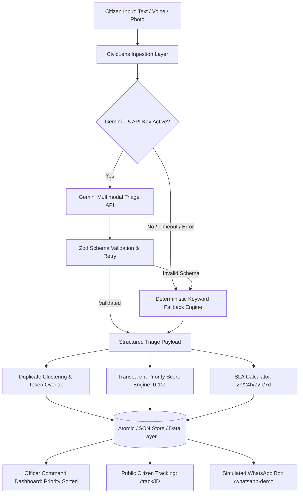

# CivicLens — AI Triage for Citizen Complaints

> **From complaint to action in seconds.**  
> An autonomous municipal triage engine that converts unstructured citizen complaints (text in English, Hindi, Kannada, plus optional hazard photos) into structured, prioritised, and correctly routed tickets.

---

## 🏛️ System Architecture



---

## 🚀 Quickstart & Setup Guide

### Prerequisites
- Node.js (v18.0.0 or higher)
- npm or pnpm

### 1. Installation
Clone the repository and install dependencies:
```bash
cd civiclens
npm install
```

### 2. Environment Configuration
Copy `.env.example` to `.env.local`:
```bash
cp .env.example .env.local
```
Add your Google Gemini API key:
```env
GEMINI_API_KEY=AIzaSy...your_gemini_api_key_here
NEXT_PUBLIC_APP_URL=http://localhost:3000
```
*(Note: If no API key is provided, CivicLens automatically engages its built-in multilingual keyword fallback engine with zero crashes).*

### 3. Run Development Server
```bash
npm run dev
```
Open **[http://localhost:3000](http://localhost:3000)** in your browser.

Or simply double-click `start.bat` on Windows!

### 4. Demo Officer Accounts (Judge Evaluation)
To access the protected Municipal Officer Command Dashboard at `/dashboard`, sign in at **`/login`** using either the 1-Click buttons or manual credentials:

| Officer Name | Department | Role / Title | Email | Demo Password |
|---|---|---|---|---|
| **Er. Ramesh Sharma** | Roads & Infrastructure | Zonal Chief Engineer | `ramesh@bbmp.gov.in` | `officer123` |
| **Smt. Ananya Rao** | Solid Waste Management | Ward 42 Executive Officer | `ananya@bbmp.gov.in` | `officer123` |
| **Er. Suresh Kumar** | Water Supply & Sewerage Board | Assistant Executive Engineer | `suresh@bbmp.gov.in` | `officer123` |
| **Smt. Priya Patel** | Electricity Dept / Streetlight Cell | Duty Officer | `priya@bbmp.gov.in` | `officer123` |

*(Note: Citizens access `/` and `/whatsapp-demo` anonymously with zero login required. All passwords are SHA-256 hashed and sessions are secured via signed, httpOnly cookies).*

---

## 🎯 5 Core Required Features

1. **Multilingual Ingestion**: Accepts unstructured free text in English, Hindi, Kannada, or mixed transliterated text, with drag-and-drop photo upload and Web Speech voice input.
2. **Strict Classification**: Automatically categorizes into **Roads, Waste, Water, Electricity, Trees, Drainage, or Other**.
3. **Severity Assessment**: Assigns **Critical, High, Medium, or Low** with an objective one-line reason (e.g. fallen live wire outside school -> Critical).
4. **Automated Department Routing**: Routes strictly to municipal bodies (Roads & Infrastructure, Solid Waste Management, BWSSB Water Board, Electricity Dept, etc.).
5. **Officer Priority Dashboard**: Real-time command center sorted by priority (Critical > High > Medium > Low, then newest first), with SLA timers, search, filter tabs, and slide-over ticket inspection drawer.

---

## 💡 Innovation Features

- **Role-Based Officer Access Control**: Citizens submit anonymously; `/dashboard` and officer APIs (`/api/tickets`, `/api/stats`, ticket actions) are strictly protected via Next.js Middleware and signed httpOnly JWT session cookies. Public routes sanitize all internal officer data (audit logs, internal notes, exact GPS masked).
- **Geospatial Intake & Leaflet Map**: Browser Geolocation API, interactive draggable OpenStreetMap pin with Bengaluru default, and Nominatim reverse geocoding on button press. Privacy-first: exact device coordinates masked for citizens.
- **Haversine Duplicate Clustering (<75 m)**: Detects physical duplicates within 75 meters in `/lib/geo.ts` (with `~X m from #ID` distance notes), seamlessly falling back to location_hint text similarity when GPS is absent.
- **Municipal Command Map View**: Live interactive GIS map with severity color-coded markers (Critical red with pulse animation, High orange, Medium amber, Low green) and duplicate cluster badges.
- **Multimodal Visual Hazard Verification**: Inspects uploaded hazard photos to confirm or correct citizen text (`image_changed_result: true`).
- **Transparent Priority Score (0–100)**: Displays exact scoring factors ("Why this rank") based on base severity, sensitive proximity, duplicate clusters, and aging.
- **Duplicate Clustering**: Unifies multiple citizen complaints on the same incident into one cluster with boosted priority.
- **Officer Override & Audit Trail**: Enables municipal officers to reclassify tickets while tracking AI vs officer agreement rate and logging authenticated officer identities.
- **SLA Countdown Timers**: Visual warning indicators for tickets approaching or breaching municipal resolution targets.
- **Citizen Status Tracking (`/track/[id]`)**: Public tracking view with live progress timeline and masked street privacy.
- **Simulated WhatsApp Intake (`/whatsapp-demo`)**: Demonstrates multi-channel citizen intake with intent pre-filters and simulated location sharing.

---

## ⏱️ 2-Minute Jury Demo Script

1. **Step 1 (0:00 - 0:30) — Citizen Filing**: Open `/` as an anonymous citizen. Notice there is no "Dashboard" in public navigation. Click **"Kannada (Critical Water Burst)"** preset. Notice the original Kannada script and draggable map pin. Click **"Triage & Route Complaint Now"**.
2. **Step 2 (0:30 - 0:50) — AI Pipeline Reveal & Tracking**: Watch the 5-step animated triage modal. View the instant Ticket Card reveal showing detected language (Kannada), English translation, Critical severity reason, and routed department. Click **"Citizen Tracking View"** to show masked street privacy.
3. **Step 3 (0:50 - 1:20) — Officer Authentication**: Click **"Officer Login"** in the top navigation bar. Demonstrate the 1-Click demo sign-in by clicking **"Er. Ramesh Sharma (Roads & Infrastructure)"**. Notice the instant signed session and automatic redirection to `/dashboard`.
4. **Step 4 (1:20 - 1:45) — Command Dashboard & Named Audit Trail**: In `/dashboard`, show the live KPI cards and switch to **"Map View 🗺️"**. Click ticket `#CVL-101001` to open the Slide-over Drawer. Show the **"Why This Rank?" (95/100)** breakdown. Click **"Override"**, adjust parameters, and save: show that the audit trail explicitly logs **"Er. Ramesh Sharma"** rather than a generic tag.
5. **Step 5 (1:45 - 2:00) — Logout & WhatsApp Intake**: Click **"Logout"**; attempt to visit `/dashboard` directly and show the automatic middleware bounce to `/login`. Then open `/whatsapp-demo` to demonstrate simulated multi-channel citizen intake.

---

## ⚠️ Limitations

1. **Fallback Translation Inability**: While the keyword fallback in `/lib/fallback.ts` detects languages and assigns accurate categories/severities, it cannot translate text without the Gemini API. The UI honestly marks these tickets with a "Keyword Fallback" badge.
2. **Landmark Extraction**: Location hints rely on textual extraction and landmarks; production deployment requires integration with municipal GIS boundary shapefiles.

---

## 📈 Scaling Roadmap

- **WhatsApp & Telegram Gateway**: Integration via Meta Cloud API / Twilio webhooks for direct citizen messaging.
- **Automated Contractor Dispatch**: SMS/WhatsApp work-order dispatch to registered municipal maintenance contractors with geo-tagged before/after photo verification.
- **Multi-City & Ward Hierarchy**: Hierarchical RBAC for Ward Engineers, Executive Engineers, and Municipal Commissioners across multiple municipal corporations (e.g. BBMP, BMC, MCD).

---

## 📜 CREDITS

- **Framework**: Next.js 14 App Router, React 18, TypeScript 5.
- **Maps & Geospatial**: Leaflet (`leaflet`, `@types/leaflet`), OpenStreetMap tiles & attribution, OpenStreetMap Nominatim reverse geocoding.
- **Styling & UI**: Tailwind CSS, Lucide React Icons, Framer Motion.
- **Charts & Data Viz**: Recharts.
- **Schema Validation**: Zod.
- **Generative AI**: Google Gemini 1.5 Flash API.
- **Placeholder Imagery**: Self-generated SVG vector graphics (`/public/samples/hazard-tree.jpg`).
- **Zero-Install Local Tools**: Node.js v26.13.1 LTS, MinGit 2.44.0.
